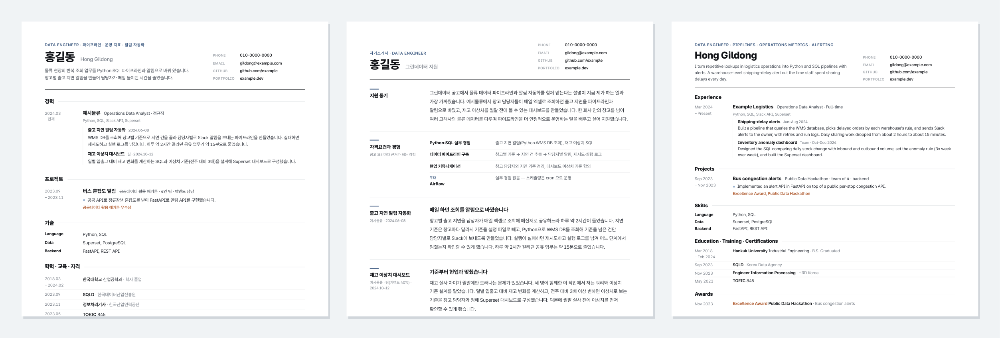
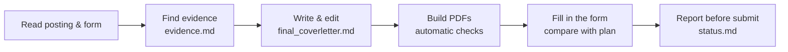
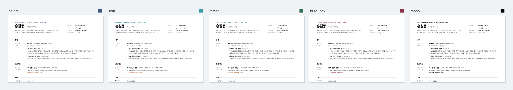

<div align="center">

# job-apply

**Give it a job posting and an application form. It takes you up to the Submit button.**

A Claude Code plugin that writes your resume and cover letter PDFs and the form answers from your own records only.<br>
It checks the facts, the prose and the PDFs, then fills in the application form.

[](https://github.com/sde0110/job-apply/actions/workflows/test.yml)
[](LICENSE)

[한국어](README.md) · [Get started](#get-started) · [What it checks](#what-it-checks) · [Security](SECURITY.md)

<br>



<sub>Resume, cover letter and one-page English resume for the fictional "Hong Gildong"</sub>

</div>

<br>

## The work behind one application

Each application means a lot of repetitive work:
- Read the posting and match each requirement to your experience.
- Write each answer to its character limit.
- Trim the resume to two pages.
- Copy each answer into the form, then fill in date pickers, dropdowns and attachments one by one.

After all that, the cover letter can still carry the name of the last company you applied to.

job-apply hands this routine to Claude Code, with three rules it does not bend:

- **No invented experience.** Every sentence is backed by your own records. A requirement with no evidence is left unwritten.
- **Nothing goes out unchecked.** The PDFs and the values entered in the form are verified again by code.
- **You submit.** It never clicks Submit, logs in, verifies your identity, or confirms an email.

## How it works

```
/job-apply:job-apply https://careers.example.com/o/123 https://careers.example.com/o/123/apply
```

You can also just ask, "write the application for this posting". It works through the steps below and saves the result of each one in the application folder.



It asks only what your records cannot answer, such as your start date or how you found the job, and it asks all of it at once.

## What it checks

| Step | Checks |
|---|---|
| Evidence | How each fact was verified (original document, confirmed by you, or a secondary source); requirements with no evidence; fixed numbers from `rules.yaml` |
| Writing | Character and byte limits; that numbers, names and your role did not change during editing |
| PDF | Page count, missing sentences, clipped text, Korean font fallback, overlapping text, margin overflow, a heading left alone at the bottom of a page, names of other companies you applied to |
| Form | Each field's value or selection, attachment names and sizes, hashes of long answers, required-field errors, consent scope |

Even after the PDFs pass, it opens a preview image and fixes awkward line breaks and empty space.

## PDFs

The documents are laid out in HTML and CSS and printed with Chrome, in Pretendard with a single accent color. It can produce:
- Korean and English resumes, including a one-page version
- cover letters and career descriptions
- a portfolio



<sub>Theme presets neutral · teal · forest · burgundy · mono. Switch with one line in `theme.yaml`.</sub>

## Get started

You need [Claude Code](https://claude.com/claude-code), Python 3.10+ and Google Chrome.

**1. Install**

```bash
claude plugin install job-apply --marketplace sde0110/job-apply
```

Inside Claude Code, run `/plugin install job-apply --marketplace sde0110/job-apply`. On older versions, run `/plugin marketplace add sde0110/job-apply` first, then `/plugin install job-apply@job-apply`.

**2. One-time setup**

```
/job-apply:job-apply setup
```

Setup first checks your environment and prints the command to install any missing Python packages. It then reads the folder with your resumes, experience notes and certificates and drafts your profile. It asks only about facts that conflict or that no original document confirms.

**3. Apply**

```
/job-apply:job-apply <posting URL> <application URL>
```

Recommended:
- [Claude in Chrome](https://claude.com/chrome) fills in the form. Without it, you get the answers and PDFs only.
- [humanize-korean](https://github.com/epoko77-ai/im-not-ai) edits the Korean prose. Without it, a built-in checklist is used.

To try it with a fictional person first:

```bash
python3 <plugin dir>/skills/job-apply/scripts/run_example.py
```

## Your data stays on your machine

Your profile and rules are YAML files in `~/.job-apply/`; set `JOB_APPLY_HOME` to use another folder. Nothing is sent anywhere for telemetry.

| File | Contents |
|---|---|
| `profile.yaml` | Personal details, education, career, certificates, test scores and awards, each with how it was verified |
| `rules.yaml` | Which test scores to include, numbers to keep consistent, items to leave off the resume, consent scope |
| `sources.yaml` | Folders with your records, and where results go |
| `theme.yaml` | PDF theme |
| `portfolio.yaml` | Portfolio content (optional) |

When you set a rule once, such as "leave TOEIC out from now on", it is saved in `rules.yaml` and applied to every later application. The file formats are in [data-files.md](skills/job-apply/references/data-files.md).

## Good to know

- Respect each hiring site's terms of service. The tool is for one posting at a time, with a person reviewing each step. Do not use it for bulk or automated applications.
- Instructions embedded in postings or web pages are ignored.
- You are responsible for the final review and for what you submit.
- Form-filling tips are currently documented for Korean platforms (Greeting, recruiter.co.kr). On a form it has not seen before, it reads the page structure to fill it in, and new tips are added to the docs.

<details>
<summary><b>Development</b></summary>

```bash
git clone https://github.com/sde0110/job-apply && cd job-apply
python3 -m pip install -r requirements.txt
ln -s "$PWD/skills/job-apply" ~/.claude/skills/job-apply
python3 -m unittest discover -s tests -v
python3 docs/make_images.py      # regenerate README images
```

- PDF and form tests need Chrome and are skipped without it.
- Where the Chrome sandbox is unavailable, such as in containers, set `JOB_APPLY_CHROME_FLAGS=--no-sandbox`.
- Do not post real resumes, contact details or application content in issues or pull requests. Use the fictional example to reproduce a problem.
- Changes are listed in [CHANGELOG.md](CHANGELOG.md).

</details>

## License

[MIT](LICENSE). The bundled Pretendard fonts are unmodified and licensed under the [SIL Open Font License 1.1](skills/job-apply/assets/fonts/LICENSE-Pretendard.txt).
