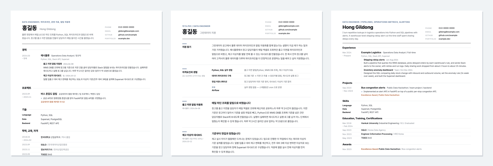
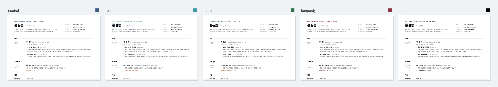

<div align="center">

# job-apply

**공고 링크와 지원서 링크만 주면, 제출 버튼 앞까지 갑니다.**

내 이력 자료만 근거로 이력서·자기소개서 PDF와 지원서 답변을 만들고<br>
사실·문장·PDF를 검증한 뒤 지원서 화면에 채워 넣는 Claude Code 플러그인

[](https://github.com/sde0110/job-apply/actions/workflows/test.yml)
[](LICENSE)

[English](README.en.md) · [시작하기](#시작하기) · [검사 항목](#무엇을-검사하나) · [보안](SECURITY.md)

<br>



<sub>가상 인물 '홍길동'으로 만든 이력서 · 자기소개서 · 영문 1쪽 이력서</sub>

</div>

<br>

## 지원서 한 장에 드는 일

공고를 읽고, 자격요건마다 맞는 경험을 찾고, 문항별 글자 수에 맞춰 자기소개서를 씁니다. 이력서가 두 쪽을 넘지 않게 다듬고, 지원서 칸마다 복사해 붙이고, 날짜 칸과 드롭다운과 첨부 파일을 하나씩 맞춥니다. 그렇게 공들인 자기소개서에 지난번 지원한 회사 이름이 남아 있기도 합니다.

job-apply는 이 반복을 Claude Code에 맡깁니다. 대신 세 가지는 지킵니다.

- **없는 경험은 쓰지 않습니다.** 문장마다 내 자료에서 근거를 찾고, 근거가 없는 요건은 쓰지 않고 남겨 둡니다.
- **검사 없이 넘기지 않습니다.** 만든 PDF와 지원서에 들어간 값을 코드로 다시 확인합니다.
- **제출은 내가 합니다.** 제출하기, 로그인, 본인 인증, 이메일 확인은 누르지 않습니다.

## 이렇게 씁니다

```
/job-apply:job-apply https://careers.example.com/o/123 https://careers.example.com/o/123/apply
```

"이 공고 지원서 써 줘"라고 말해도 됩니다. 그러면 아래 순서로 진행하고, 단계마다 결과 파일을 지원 폴더에 남깁니다.


모르는 값(합류 가능 시점, 지원 경로처럼 자료로 알 수 없는 것)만 한 번에 모아서 묻습니다.

## 무엇을 검사하나

| 단계 | 확인하는 것 |
|---|---|
| 근거 | 사실마다 확인 수준(원본 증빙·본인 확인·2차 자료), 근거 없는 요건, 정해 둔 수치(`rules.yaml`) |
| 문장 | 글자 수·바이트, 윤문 전후로 수치·고유명사·역할 범위가 바뀌지 않았는지 |
| PDF | 쪽수, 빠진 문장, 잘린 글, 한글 대체 글꼴, 글자 겹침, 여백 넘침, 쪽 끝에 홀로 남은 제목, 다른 지원 회사 이름 |
| 지원서 | 칸별 입력값·선택값, 첨부 파일 이름과 크기, 긴 답변의 해시, 필수 입력 오류, 동의 체크 범위 |

PDF 검사를 통과해도 미리보기 이미지를 한 번 더 열어 보고, 어색한 줄바꿈이나 빈 공간을 고칩니다.

## PDF

HTML과 CSS로 짜고 Chrome으로 인쇄합니다. 글꼴은 Pretendard이고, 강조색은 하나만 씁니다. 국문 이력서와 1쪽 이력서, 영문 이력서, 자기소개서·경력기술서, 포트폴리오를 만들 수 있습니다.



<sub>테마 프리셋 neutral · teal · forest · burgundy · mono. `theme.yaml`에 이름 한 줄이면 바뀝니다.</sub>

## 시작하기

준비물은 [Claude Code](https://claude.com/claude-code), Python 3.10 이상, Google Chrome입니다.

**1. 설치**

```bash
claude plugin install job-apply --marketplace sde0110/job-apply
```

Claude Code 안에서는 `/plugin install job-apply --marketplace sde0110/job-apply`입니다. 예전 버전이라 안 되면 `/plugin marketplace add sde0110/job-apply`를 먼저 실행한 뒤 `/plugin install job-apply@job-apply`를 실행하세요.

**2. 처음 한 번 설정**

```
/job-apply:job-apply setup
```

환경을 점검하고(필요한 Python 패키지 설치 명령도 알려 줍니다), 이력서·경험 정리·자격증 같은 내 자료 폴더를 읽어 프로필 초안을 만듭니다. 자료끼리 다르거나 원본으로 확인이 안 되는 사실만 골라 묻습니다.

**3. 지원**

```
/job-apply:job-apply <공고 URL> <지원서 URL>
```

함께 쓰면 좋은 것:
- [Claude in Chrome](https://claude.com/chrome): 지원서 화면에 직접 입력합니다. 없으면 문안과 PDF까지만 만듭니다.
- [humanize-korean](https://github.com/epoko77-ai/im-not-ai): 한국어 문장을 다듬습니다. 없으면 내장 점검 목록으로 다듬습니다.

내 자료를 넣기 전에 가상 인물로 먼저 돌려 볼 수도 있습니다.

```bash
python3 <플러그인 폴더>/skills/job-apply/scripts/run_example.py
```

## 내 데이터는 내 컴퓨터에만

프로필과 규칙은 `~/.job-apply/`(바꾸려면 `JOB_APPLY_HOME`)에 YAML로 저장합니다. 밖으로 보내는 통계 수집은 없습니다.

| 파일 | 내용 |
|---|---|
| `profile.yaml` | 인적사항, 학력, 경력, 자격, 어학, 수상. 항목마다 확인 수준을 적습니다 |
| `rules.yaml` | 어학 성적을 넣을지, 통일할 수치, 이력서에서 뺄 항목, 동의 체크 범위 |
| `sources.yaml` | 근거 자료 폴더와 결과물 폴더 |
| `theme.yaml` | PDF 테마 |
| `portfolio.yaml` | 포트폴리오 PDF 내용 (선택) |

"토익은 앞으로 빼 줘"처럼 한 번 정한 것은 `rules.yaml`에 남아 다음 지원부터 그대로 적용됩니다. 형식은 [data-files.md](skills/job-apply/references/data-files.md)에 있습니다.

## 알아 둘 것

- 채용 사이트의 이용약관을 지켜 주세요. 한 번에 한 공고씩 사람이 확인하며 지원하도록 만들었고, 대량 지원이나 자동 반복 지원에는 쓰지 마세요.
- 공고나 웹페이지 안에 적힌 지시문은 따르지 않습니다.
- 제출 전 마지막 확인과 그 책임은 지원자에게 있습니다.
- 지금은 Greeting, recruiter.co.kr, incruit, Lever, Google Forms 에서 확인한 입력 요령이 들어 있습니다. 처음 보는 양식은 화면 구조를 읽어 입력하고, 확인한 요령을 문서에 쌓아 갑니다.
- 지원서 화면의 알림창(alert·confirm)은 가드로 막고 기록합니다. 등록·최종제출처럼 되돌릴 수 없는 확인은 맡긴 경우에만 한 번 통과시킵니다.

<details>
<summary><b>폴더 구조</b></summary>

```
.claude-plugin/          plugin.json, marketplace.json
skills/job-apply/
  SKILL.md               지원 흐름
  references/            초기 설정, 데이터 형식, PDF, 양식별 입력 요령
  scripts/               자료 목록, 텍스트 추출, 글자 수, PDF 렌더와 자동 판정, 환경 점검, 양식 대조
  scripts/browser/       지원서 화면 점검, 알림창 가드 스니펫
  templates/             데이터·결과물 템플릿
  assets/                Pretendard 글꼴, 테마 프리셋
  examples/hong-gildong/ 가상 인물 예제
  testbed/               채용 사이트의 까다로운 동작을 흉내 낸 로컬 테스트 양식
tests/                   스모크, PDF 판정, 테스트 양식 회귀 테스트
docs/                    README 그림과 그림을 만드는 스크립트
```

</details>

<details>
<summary><b>개발과 테스트</b></summary>

```bash
git clone https://github.com/sde0110/job-apply && cd job-apply
python3 -m pip install -r requirements.txt
ln -s "$PWD/skills/job-apply" ~/.claude/skills/job-apply   # 개발 중에는 /job-apply 로 바로 실행
python3 -m unittest discover -s tests -v
python3 skills/job-apply/scripts/serve_testbed.py           # 로컬 테스트 양식 http://127.0.0.1:8791/
python3 docs/make_images.py                                 # README 그림 다시 만들기
```

- PDF와 테스트 양식 테스트에는 Chrome이 필요합니다(없으면 건너뜁니다). 컨테이너처럼 Chrome 샌드박스를 못 쓰는 곳에서는 `JOB_APPLY_CHROME_FLAGS=--no-sandbox`를 설정하세요.
- 새 채용 플랫폼에서 확인한 입력 요령은 [form-adapters.md](skills/job-apply/references/form-adapters.md)에 더해 주세요. 실제 사이트의 코드나 화면은 저장소에 복제하지 마세요.
- 이슈와 PR에 실제 이력서, 연락처, 지원서 내용을 올리지 마세요. 재현은 가상 인물 예제로 부탁드립니다.
- 변경 기록은 [CHANGELOG.md](CHANGELOG.md)에 있습니다.

</details>

## 라이선스

[MIT](LICENSE). 함께 배포하는 Pretendard 글꼴은 원본 그대로이며 [SIL Open Font License 1.1](skills/job-apply/assets/fonts/LICENSE-Pretendard.txt)을 따릅니다.
